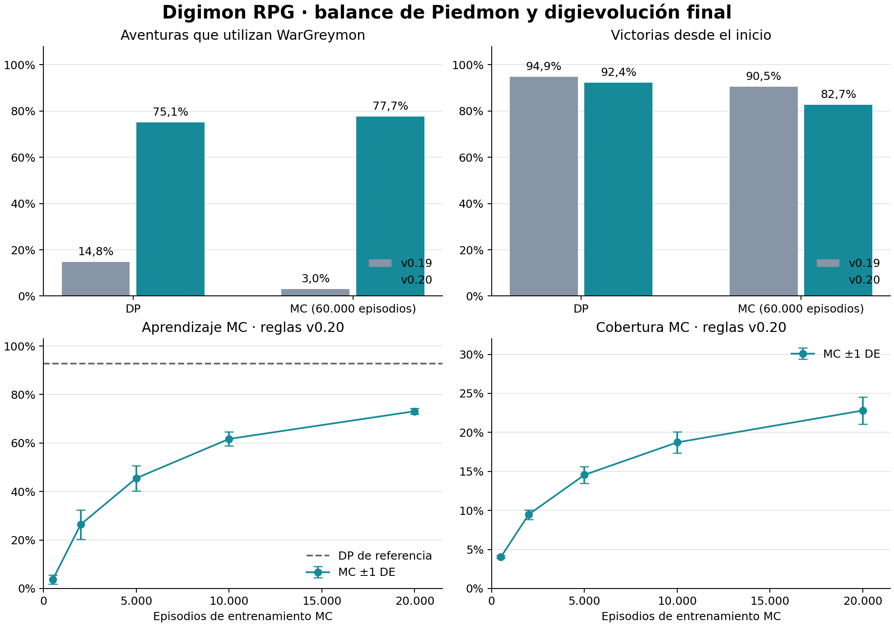

# Balance v0.20 — Piedmon y la evolución final

## Problema comprobado

En las reglas anteriores, Piedmon tenía 6 PS. MetalGreymon con núcleo podía
infligir 6 con Giga Destroyer y finalizar sin contraataque. Evolucionar de nuevo
costaba 3 EN y otro turno, mientras que MetalGreymon y WarGreymon tenían la misma
reducción pasiva de daño. Ganar con MetalGreymon era una consecuencia razonable
de las reglas, no un fallo de Value Iteration o Monte Carlo.

## Cambios de reglas

| Elemento | v0.19 | v0.20 |
| --- | --- | --- |
| Vida inicial de Piedmon | 6 PS | 9 PS |
| Coste de evolucionar a WarGreymon | 3 EN | 2 EN |
| Resistencia pasiva MetalGreymon | hasta 1 PS | hasta 1 PS |
| Resistencia pasiva WarGreymon | hasta 1 PS | hasta 2 PS |
| Coste de Terra Force | 3 EN | 3 EN |
| Precisión de Terra Force | 85 % | 85 % |

La reducción pasiva deja al menos 1 PS de daño cuando el golpe enemigo acierta.
La protección del turno de digievolución sigue siendo temporal y puede absorber
por completo ese golpe. La acción consume su turno y su energía. No se añaden
premios por usar una forma, evoluciones automáticas ni requisitos de forma para
rematar al jefe. Giga Destroyer sigue siendo útil, pero no derrota al jefe con
sus 9 PS completos, incluso con núcleo y entrenamiento. Terra Force con núcleo
sí puede lograrlo al acertar; sigue teniendo un 15 % de fallo.

Se mantienen siete regiones, seis enemigos, cuatro formas y diez variables de
estado. Esta entrega aborda el balance antes de ampliar rutas o contenido.
Los otros enemigos y las recompensas no cambian.

## Comparación antes y después

Tres semillas de evaluación (2042, 3042 y 4042), 1.000 partidas por semilla y
método: **3.000 aventuras por política y edición**. Ambas políticas MC tienen
60.000 episodios de entrenamiento con semilla 42; cada edición utiliza sus
propias reglas y sus políticas entrenadas para ellas. Evaluación greedy,
γ=0,95 y límite de 80 turnos. Una aventura «utiliza WarGreymon» si tiene al menos
una decisión con esa forma, gane o pierda; el denominador incluye todas las
aventuras iniciadas.

| Método | Usa WarGreymon antes | Usa WarGreymon ahora | Victorias antes | Victorias ahora |
| --- | --- | --- | --- | --- |
| Value Iteration | 14,8% | 75,1% | 94,9% | 92,4% |
| Monte Carlo (60.000 episodios) | 3,0% | 77,7% | 90,5% | 82,7% |

El jefe es más exigente y la tasa de victoria baja. El objetivo de este ajuste
es dar valor a la digievolución final y al manejo de recursos, no aumentar la
tasa de victoria. Las semillas se reutilizan, pero las trayectorias no son
idénticas. La comparación mide el conjunto del cambio de reglas y del nuevo
entrenamiento; no aísla la contribución individual de cada parámetro ni prueba
superioridad universal.

MetalGreymon aún gana algunas aventuras. Por ejemplo, la política DP elige
atacar con MetalGreymon cuando Piedmon conserva 1 PS, el héroe tiene 6 PS y 2 EN,
poción disponible, sin núcleo ni mejora y XP 2. En cambio, con Piedmon a 9 PS,
el héroe a 6 PS y 5 EN, núcleo y XP 2, elige evolucionar. Son decisiones de la
política calculada: no existe una regla de interfaz que obligue a hacerlo.

Fuentes crudas: `resultados/balance_v020/antes_v019.json` y `despues_v020.json`.
También se registran forma del golpe final, llegada al jefe, respaldo y
truncamiento. No hubo truncamientos en las 3.000 evaluaciones actuales de cada
método. MC usó 12 acciones de respaldo y DP ninguna.

## Nuevo modelo y aprendizaje

- Reglas: `v0.20-balance-piedmon`; formato de política 6, con identificador de
  reglas distinto para rechazar políticas antiguas.
- Estados no terminales alcanzables: **60.649**; además, dos terminales.
- Combinaciones nominales, incluidas inalcanzables y terminales: **564.482**.
- DP: 35 iteraciones, tolerancia 10⁻⁸ y último cambio máximo ≈7,57×10⁻⁹.
- MC del juego: 60.000 episodios completos, ninguno truncado; 18.727 estados y
  43.969 pares estado-acción actualizados. ε=0,15, γ=0,95, semilla 42.
- El laboratorio T contiene V de DP, Q y visitas MC vinculados a las políticas
  actuales mediante hashes.

Las nuevas curvas usan cinco semillas de entrenamiento (41–45), checkpoints
500, 2.000, 5.000, 10.000 y 20.000, y 200 evaluaciones por semilla/método/punto.
A 20.000 episodios, MC obtiene **73,1 % ±1,2 puntos porcentuales** de victorias,
frente a una referencia DP de **92,7 %**. La cobertura media MC es 22,8 % y su
respaldo medio es 0,30 % de las acciones. Las barras son ±1 desviación estándar
muestral entre cinco semillas, no intervalos de confianza.

Estas curvas no son la evaluación de la política de 60.000 episodios del juego.
F4 y F5 muestran la serie actual en `resultados/convergencia_v020/`, con eje
horizontal lineal. Los datos v0.11 permanecen intactos como referencia histórica.



## Reproducción y validación

Con Python 3.11 o superior y las dependencias del proyecto:

```console
python scripts/reproducir_balance_antes_v019.py
python scripts/entrenar_balance_v020.py --episodes 60000
python scripts/curvas_aprendizaje_v020.py
python scripts/validar_balance_v020.py
python scripts/validar_jefe_v020.py --headless
python -m unittest discover -s tests -v
```

El entorno de ejecución debe tener el proyecto instalado (`pip install -e
".[game]"`) o `PYTHONPATH=src`. Los BAT ya configuran esa ruta. La figura opcional
se regenera con `python scripts/graficar_balance_v020.py` y requiere matplotlib.
El motor histórico exacto está en `referencia_v019/`, usado únicamente por el
script de comparación. La GUI carga el paquete de `src/` y las políticas de la
raíz de `politicas/`. Los modelos de aprendizaje no cambiaron.

**169 pruebas aprobadas, sin omisiones**, con Pygame 2.6.1 y SDL dummy en Linux.
Ocho pruebas nuevas cubren resistencia, costes, aciertos, fallos, supervivencia
del jefe completo y compatibilidad de políticas. La comprobación de curvas y
estadísticas se registra aparte. Las capturas del combate proceden de una
trayectoria real DP con semilla 42, de 13 turnos y victoria; dibujar no altera
el estado, los turnos ni el generador aleatorio.

Para Windows, extraer en una carpeta nueva, abrir `JUGAR_WINDOWS.bat`, probar
F1/F2/F3, controles y sonido, cerrar y ejecutar `VALIDAR_WINDOWS.bat` (12 pasos).
La aceptación visual y sonora nativa sigue pendiente; los registros Linux no
la certifican. Se conserva el aviso existente de recursos de terceros.

## Relación con el informe académico

El Word v0.19, sus figuras y sus mediciones permanecen como documentos
históricos. Su auditoría usa las políticas archivadas. No debe entregarse como
si describiera las nuevas reglas sin integrar este anexo y revisar sus cifras,
figuras, discusión y guion. Este archivo reúne los parámetros y resultados que
corresponden al juego v0.20. La URL pública de entrega sigue pendiente.
