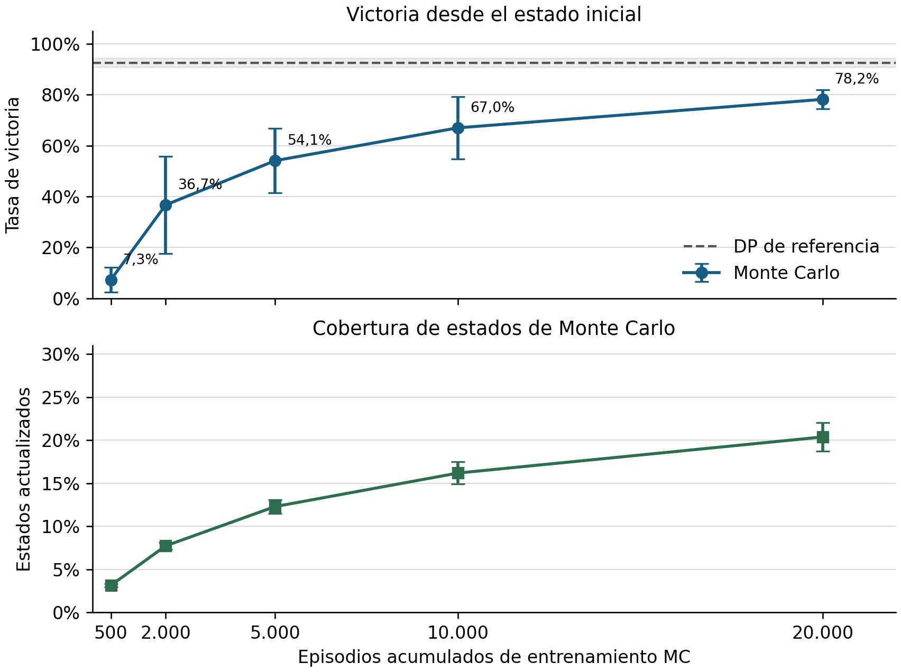

# v0.21 — Rutas opcionales y Guardromon

## Contenido nuevo

El mapa pasa de siete a **nueve regiones** y de ocho a **catorce conexiones**.
Se mantienen todos los caminos de v0.20. Ningún desvío es obligatorio y el grafo
no tiene ciclos: no se puede volver al refugio o repetir el botín indefinidamente.

| Desvío | Entrada | Efecto y coste | Salida |
| --- | --- | --- | --- |
| Refugio de Cristal | Bosque o Caverna despejados | Restaura hasta 2 PS y 1 EN, repone la poción; consume un turno y recompensa −4 | Pantano de Datos |
| Abismo Corrupto | Ruinas o Torre despejadas | Entrada −2; combate opcional contra guardián de 6 PS | Fortaleza Virus |

El Refugio no tiene enemigo. Los recursos nunca superan los máximos de 6; al
salir se aplica el riesgo normal de avance (10 % de emboscada). El beneficio
compite con el coste de viajar y el descuento del retorno; no es una curación
sin coste ni una parada obligatoria.

Vencer al Guardromon entrega un núcleo de datos y hasta 2 EN adicionales,
además del premio normal de combate y XP. El bonus de recompensa por obtener
el núcleo es +4 únicamente si aún no estaba disponible. El botín se concede
al derrotarlo, nunca en un fallo ni al entrar. Buscar recursos desde el Abismo
continúa hacia la Fortaleza: no permite repetir el combate.

## Enemigos y decisiones

Hay **siete enemigos**, todos Digimon canónicos. Guardromon utiliza el sprite
pixelado del mismo repositorio Digidex que los personajes anteriores. Es un
Digimon de tipo Máquina y su técnica oficial es Destruction Grenade, según la
[enciclopedia oficial](https://digimon.net/reference_en/detail.php?directory_name=guardromon).
La técnica usa el efecto y sonido de misiles ya incluidos, con su nombre correcto
en combate. La galería conserva sus 13 efectos visuales compartidos.

Los PS, la armadura y el botín son parámetros de este RPG; no se presentan como
estadísticas oficiales de la franquicia. Esta corrección v0.21.1 conserva las
transiciones y políticas de v0.21 sin reentrenamiento.

- Andromon tiene armadura 1 mientras no prepara un ataque.
- El Guardromon tiene armadura 2 en esa misma condición.
- Ambas armaduras desaparecen cuando el enemigo anuncia un golpe cargado.
- Guardromon carga con probabilidad 25 % por turno normalmente; si le quedan
  3 PS o menos tras la acción del jugador, la probabilidad pasa a 65 %.
- Las técnicas conservan su perforación de armadura; interrumpir sigue siendo
  una alternativa ante un ataque anunciado.

La armadura depende del estado visible. No se añade memoria oculta, un agente
enemigo entrenado ni un método de aprendizaje distinto. La ayuda contextual y
los tooltips de mapa explican las decisiones. Los clics de destino solo se
habilitan cuando la acción es legal y la presentación del turno ha terminado.

Se conserva el balance de v0.20: Piedmon tiene 9 PS, WarGreymon cuesta 2 EN y
reduce hasta 2 PS por golpe (mínimo 1). Las evoluciones se habilitan por regiones
explícitas; los nuevos identificadores numéricos no permiten evolucionar antes
de tiempo. WarGreymon sigue reservado a la Fortaleza.

## Modelo y entrenamiento

- Reglas: `v0.21-rutas-y-guardian`; las políticas anteriores se rechazan.
- **85.609 estados no terminales alcanzables**, más dos terminales.
- Diez componentes por estado; 725.762 combinaciones nominales con terminales,
  incluidas las combinaciones inalcanzables.
- DP recalculado: 41 iteraciones, último delta ≈3,25×10⁻⁹, tolerancia 10⁻⁸.
- Política MC jugable: **120.000 episodios**, semilla 42, ε=0,15, γ=0,95;
  120.000 completos, cero truncados; 27.774 estados y 67.387 pares actualizados.
- Los algoritmos de `agents.py` y las técnicas de cada forma no se modifican.
  Se mantienen VI y MC on-policy First-Visit manuales, sin bibliotecas RL.
- T utiliza valores y visitas nuevos vinculados por hash a estas políticas.

El primer diagnóstico utilizó 60.000 episodios. Se amplió a 120.000 por el
crecimiento del modelo. El registro final y las políticas del ZIP corresponden
al presupuesto de 120.000; esta es una revisión de desarrollo y no un conjunto
de evaluación reservado que no se haya observado durante el ajuste.

## Evaluación de las políticas jugables

Tres semillas (2042, 3042 y 4042), 1.000 aventuras por semilla y método,
políticas greedy congeladas, γ=0,95 y máximo 80 turnos. Todas las proporciones de
la tabla usan como denominador **3.000 aventuras iniciadas por método**, incluidas
las derrotas. No son proporciones condicionadas a llegar a una región o ganar.

| Método | Victorias | Visita Refugio | Visita Abismo | Usa WarGreymon |
| --- | --- | --- | --- | --- |
| Value Iteration | 91,7% | 5,1% | 56,2% | 69,6% |
| Monte Carlo (120.000 episodios) | 85,6% | 1,7% | 7,2% | 40,6% |

Las rutas responden a circunstancias distintas; no están programadas como
preferencias del agente. MC aproxima las decisiones mediante experiencia y
no alcanza la misma política que DP. Mantener los costes y la armadura de
WarGreymon no garantiza la misma frecuencia de evolución que en v0.20: cambian
las rutas, las distribuciones de estados y lo aprendido. No se fuerza una forma
para que aparezca en pantalla.

En estas evaluaciones no hubo truncamientos. DP no usó respaldo y MC usó seis
acciones sin una entrada aprendida. La política MC usa entonces la primera
acción legal, como en las versiones anteriores; el uso se registra.

Fuentes: `resultados/balance_v021/despues_v021.json`, sus evaluaciones completas
y el export de políticas. Las semillas comunes no garantizan trayectorias
idénticas entre métodos o ediciones.

## Curvas y límites de interpretación

La serie nueva entrena MC con semillas 41–45 y checkpoints acumulativos de
500, 2.000, 5.000, 10.000 y 20.000 episodios. Por método, punto y semilla se
juegan 200 evaluaciones greedy. F4 y F5 muestran esta serie v0.21.

A 20.000 episodios, la victoria media MC es **78,2 % ±3,8 puntos porcentuales**;
DP obtiene una referencia de **92,6 %**. Cobertura MC media: 20,4 %; respaldo:
0,21 % de las acciones. Las barras son ±1 desviación estándar muestral entre
cinco semillas, no intervalos de confianza ni prueba de convergencia formal.

Esta serie **no es la evaluación de la política jugable de 120.000 episodios**.
Sus semillas y presupuestos difieren. Se conservan las series v0.11 y v0.20,
identificadas como históricas, y no se combinan sus cifras con las nuevas.



## Verificación y Windows

Las pruebas de esta corrección se registran en `resultados/pruebas_v0211.txt`.
Se añadieron nueve pruebas de los desvíos: límites de recursos, botín solo al
vencer, grafo sin ciclos, evolución por región, armadura visible y animación del
nuevo enemigo. Las comprobaciones gráficas recorren los catorce caminos, las
nueve regiones y las cuatro formas, incluyendo clics, fondos ausentes y cambios
de resolución. Las capturas son evidencia de software y no nuevos experimentos.

El Refugio se ilustra con una elección manual legal después de un prefijo DP,
semilla 59 (salud 3 → 5). El Abismo se muestra en una aventura real de DP con
semilla 42, victoria en 16 turnos. Dibujar conserva estado, turnos y RNG.

Extraer todo el ZIP en una carpeta nueva, ejecutar `JUGAR_WINDOWS.bat`, revisar
controles y audio, cerrar el juego y abrir `VALIDAR_WINDOWS.bat` (14 pasos).
La validación adjunta utiliza Linux y SDL dummy. No certifica ejecución nativa
ni escucha física en Windows; esas comprobaciones siguen pendientes.

```console
python scripts/entrenar_balance_v021.py --episodes 120000
python scripts/curvas_aprendizaje_v021.py
python scripts/validar_balance_v021.py
python scripts/validar_rutas_v021.py --headless
python -m unittest discover -s tests -v
```

Usar el proyecto instalado (`pip install -e ".[game]"`) o `PYTHONPATH=src`.
Los BAT preparan las rutas automáticamente. Regenerar figuras requiere
matplotlib opcional; jugar y validar el balance no lo requiere.

## Continuidad académica

El Word v0.19 y el anexo v0.20 se conservan como documentos históricos. Antes de
la entrega final deben actualizarse con este modelo, resultados y figuras;
no presentan los 85.609 estados ni estas políticas. La evidencia v0.20 se valida
con su motor y políticas archivados en `referencia_v020/` y
`politicas/historico_v020/`. No se cargan para jugar.

Los créditos de Digidex se mantienen en `CREDITOS.md`; los fondos y la procedencia del sprite
se documentan en `assets/ARTE_ORIGINAL_v021.md`. La ejecución manual en Windows fue
confirmada posteriormente por el usuario. El README principal identifica la entrega vigente.
